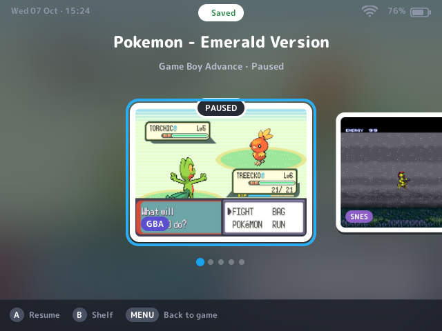
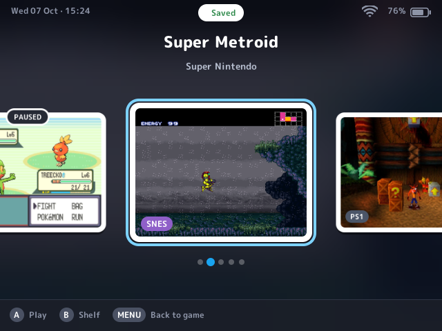

# Shelf

A DSi/3DS-style home screen for the Miyoo Mini and Mini Plus, running on top of
[Onion OS](https://github.com/OnionUI/Onion). Your games as square icons; press A to play.

| Home | Folder | Dark mode |
|---|---|---|
|  |  |  |

| Game switcher (MENU in a game) | Switching |
|---|---|
|  |  |

## What it does

- **Home row:** recent games, then folders for All games, Favorites and each console, with
  springy DS-style scrolling.
- **Folders:** a grid beside a detail panel showing the selected game's art, play time
  (from Onion's play activity), last played and favorite. Y cycles the sort.
- **Plays through Onion:** games launch via Onion's runtime, so saves, play time and the
  game switcher work as usual, and every game returns to Shelf.
- **Replaces Onion's menu (optional):** boot straight into Shelf. Hold SELECT at boot, or
  use Options, to get stock Onion back. No Onion files are modified.
- **Experimental game switcher:** the custom overlay is **not stable** across game
  switching and sleep/wake. Keep stock Onion GameSwitcher enabled (see Install).
  When experimenting with the custom overlay, MENU opens Shelf's switcher. The
  paused game shrinks into a card among your recent games, each showing where you left it.
  A resumes or switches, B goes to Shelf. On legacy RetroArch, switching/exiting writes
  the normal exit autosave; resuming keeps the same live game.
- **Status bar, sound, dark mode:** clock, Wi-Fi and battery; the Onion theme's click sound;
  a dark palette under START → Options.
- Uses your existing box art and Onion's recents and favorites files.

Status: early; the game switcher is new and still being tested on the device. MENU in
Shelf opens Onion's menu.

## Controls

D-pad moves · A play/open · B back · Y sort · L1/R1 jump · START options · MENU Onion's menu

## Install

```sh
make mm                            # build for the device (podman or docker)
MM_HOST=<device-ip> make push      # copy to App/Shelf over SSH (enable SSH in Onion's Tweaks)
MM_HOST=<device-ip> make switcher-off # retain stock switcher/keymon; custom overlay is unstable
MM_HOST=<device-ip> make boot-on   # optional: boot into Shelf (make boot-off undoes it)
```

Without SSH, copy `build/mm/shelf`, `assets/app/*` and `assets/fonts/` to `App/Shelf/` on
the SD card, then open **Apps → Shelf**.

On **Onion 4.3.1-1**, stock keymon exits the game before opening GameSwitcher. `make push`
uses Python 3.12+ to download checksum-pinned Onion sources, builds a minimal overlay
handoff backport, and installs `App/Shelf/keymon-overlay`. Boot mode bind-mounts it without
changing Onion's original file; `make boot-off` unmounts it and restarts stock keymon.
`make switcher-off` persistently disables both custom switcher and keymon mounts while
leaving Shelf's home hook intact; reboot and `make push` respect that choice. This is the
recommended mode until switching, sleep/wake and real display ownership are validated.
Newer Onion versions retain their own keymon. For offline installation, run `make keymon`
and also copy `build/mm/keymon-overlay` and `assets/compat/LICENSE` (as
`keymon-overlay-LICENSE`) to `App/Shelf/`.

Legacy RetroArch 1.15 uses `PAUSE_TOGGLE` and has no acknowledged overlay autosave command.
Shelf displays **Saves on exit**; keep RetroArch's `savestate_auto_save` enabled. It does
not overwrite user state slots or force-kill an exit save. Overlay mode renders directly
to fb0 and reads evdev without switching RetroArch's locked console. After saving,
Shelf suspends RetroArch's renderer so it cannot overwrite the paused menu, and resumes
the process before unpausing or exiting the game.

For device trials, explicitly re-enable the overlay with
`MM_HOST=<device-ip> tools/mm.sh 'sh /mnt/SDCARD/App/Shelf/boot.sh switcher-on'`.
Use `make switcher-off` to restore stock behavior.

For overlay development only, with a game already running, test pause/resume via:
`MM_HOST=<device-ip> sh tools/test_device_overlay.sh` (after `make mm` and `make push`).
This checks process state and sampled framebuffer memory, not the actual panel or full
switch/sleep lifecycle; passing it does **not** establish that the overlay is safe.
`MM_HOST=<device-ip> sh tools/test_device_switch_sleep.sh` additionally switches between
Apotris and Lazarus and operates the real POWER button in-game and inside the overlay.
Do not interrupt this test during sleep: the SSH processes are temporarily suspended.

## Power / standby

On the tested Mini Plus (Onion 4.3.1-1), short POWER stops foreground processes and
selects the CPU's powersave governor, but `/sys/power/state` exposes no kernel suspend
mode. This is standby, not power-off; it can still drain the battery. A sleep timer of
**Never** leaves standby running indefinitely.

For longer breaks, use Onion's **Apps → Tweaks → Button shortcuts → Power single press
→ Shutdown**. This uses Onion's normal save/shutdown path; power on again to resume.
Shelf does not change this preference during installation.

To check process suspension and the CPU governor on-device (not temperature or battery
consumption): `MM_HOST=<ip> tools/mm.sh '/tmp/shelf-device-probe standby $(pidof shelf)'`
after copying `build/mm/device-probe` to `/tmp/shelf-device-probe`. The probe wakes the
device after three seconds and refuses to run when single-press shutdown is enabled.

## Develop

Needs SDL2 (`brew install sdl2`).

```sh
make run     # simulator against a sample SD card in fixture/
make test    # library, UI cache and graphics tests
make shots   # headless screenshots into docs/screenshots
```

Simulator keys: arrows, `Z` = A, `X` = B, `S` = Y, `Q`/`W` = L1/R1, `O` = START, `M` = MENU.

Everything is plain C with a software renderer: `src/ui.c` (screens), `src/library.c` (reads
Onion's SD card), `src/icons.c` (art cache), `src/switcher.c` (game switcher: RetroArch,
screenshots), `src/platform_*.c` (device vs simulator).

The switcher in the simulator: `SHELF_SWITCHER=overlay SHELF_FRAME=<picture of the paused
game>` with the usual `SHELF_ROOT`/`SHELF_FONTS`.

## Credits

[Onion OS](https://github.com/OnionUI/Onion), [Allium](https://github.com/goweiwen/Allium)
for the simulator-first idea, [stb](https://github.com/nothings/stb),
[cJSON](https://github.com/DaveGamble/cJSON) (MIT), M PLUS Rounded 1c (SIL OFL 1.1,
`assets/fonts/OFL.txt`), sample box art and game
snaps from [libretro-thumbnails](https://github.com/libretro-thumbnails).

MIT licensed (see `LICENSE`); bundled code and fonts keep their own licenses.
The optional Onion keymon backport is GPL-3.0 (see `assets/compat/LICENSE`); its complete
source is reproducibly prepared by `tools/prepare_keymon.py` plus `assets/compat/keymon-overlay.h`.
