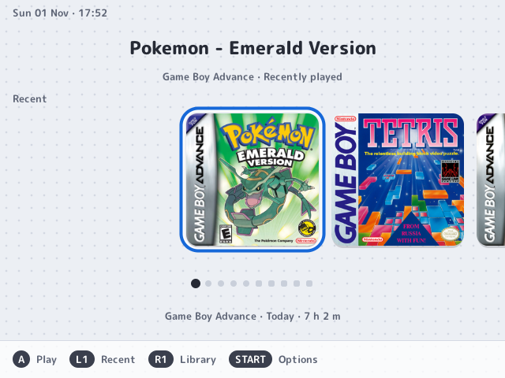
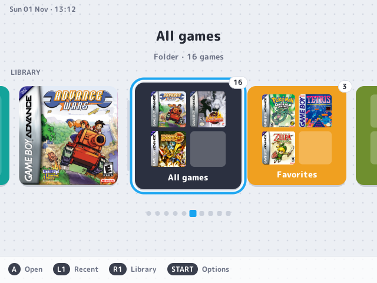
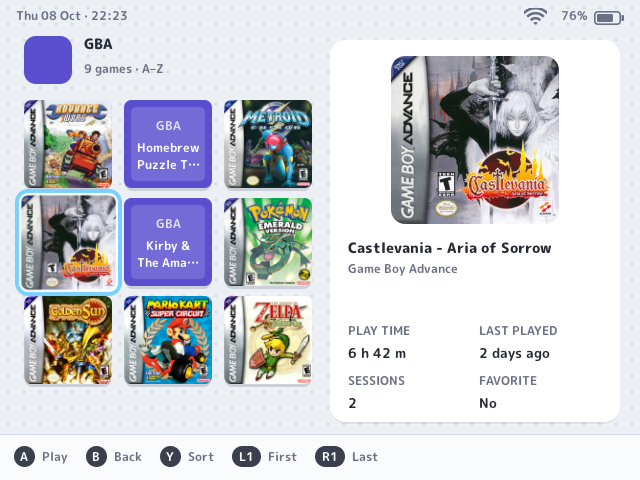
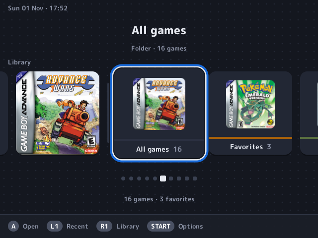
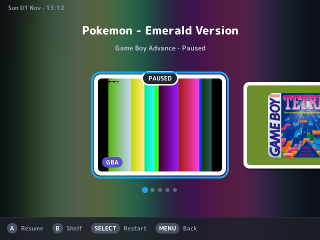
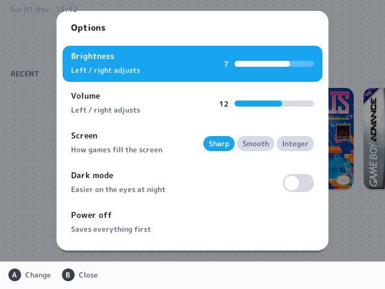

# Shelf

Shelf turns the SD card of a Miyoo Mini or Mini Plus into a standalone console. It plays
Game Boy, Game Boy Color and Game Boy Advance games, and nothing else. There is no Onion
and no RetroArch: the stock firmware runs the card's `.tmp_update/updater` at boot instead
of its own UI, so the card holds the whole system — games, saves, box art and settings.
Remove the `.tmp_update` folder and the device boots the stock firmware again.

Games run inside Shelf, through libretro cores cross-built for the device at pinned
commits: gambatte for GB and GBC, mGBA for GBA (`make cores`).

| Home | Folders | Folder |
|---|---|---|
|  |  |  |

| Dark mode | In-game menu (MENU) | Options (START) |
|---|---|---|
|  |  |  |

## Using it

- **Home** is one row: recent games first, then the folders. L1 jumps to the recents, R1 to
  the folders.
- **Folders** (All games, Favorites, GB, GBC, GBA) are a grid beside a detail panel with the
  selected game's art, play time, sessions, last played date and favorite state. Y cycles the
  sort (A–Z, recent first, favorites first); X toggles the favorite.
- **A plays.** A game resumes exactly where you left it: leaving one writes a save state, and
  starting it again loads that state.
- **MENU** in a game opens the card switcher. The paused game shrinks into the row of recent
  games, each card showing its screenshot. A resumes the selected card, A on another card
  switches to that game, B goes back to Shelf, SELECT restarts (and asks first).
- **POWER** sleeps and wakes; the screen goes dark at once and the game is saved while it
  sleeps. Holding it for two seconds saves everything and powers off; Shelf also powers off
  after 10 minutes asleep. Powered off from a game, by either, the next boot goes straight
  back into that game; from the home screen it boots to home. Options → Power off asks for a
  second press.
- **Idle**: the home screen and the in-game menu dim after 45 seconds without a press and
  sleep after 3 minutes. The press that wakes a dimmed screen does nothing else. A game
  sleeps after 10 minutes with no change in the buttons held.
- **Battery**: read every 30 seconds, in games too. At 10 % the home screen or in-game menu
  says so once. At 4 %, three readings in a row and not charging, Shelf saves the game and
  powers off, to resume it once charged.
- **Options** (START, or MENU outside a game): brightness, volume, screen scaling, dark mode,
  power off. Changes are applied at once and saved to `.shelf/data/settings.json`.
  Screen scaling is Sharp (sharp-bilinear fill), Smooth (bilinear fill) or Integer (whole
  multiples, nearest neighbour).
- The status bar shows the clock, battery level and charging; navigation plays a click.
- **Colours** look right without a settings screen. Game Boy games get the Game Boy
  Pocket's soft grey-green instead of plain grey; Game Boy Color and Game Boy Advance
  games are colour corrected to look like those consoles' own screens. Frame blending is
  off (it costs battery) and boot logos are skipped.

### Core options

Shelf sets the cores' options it cares about itself (`src/core_options.c`). A
RetroArch-style `.shelf/data/gambatte.opt` or `mgba.opt` (`key = "value"` lines) overrides
any of them, and sets anything else the core offers.

## Controls

D-pad moves · A play/open · B back · X favorite · Y sort · L1/R1 first/last · START options ·
MENU switcher in a game, options elsewhere · POWER sleep, hold to power off.

## Card layout

```
Roms/GB/            *.gb *.gbc *.dmg *.sgb
Roms/GBC/           *.gb *.gbc *.dmg *.sgb
Roms/GBA/           *.gba
Roms/<SYS>/Imgs/    <game name>.png box art, game name = ROM file name without extension
Saves/<SYS>/        <game>.srm battery save (.rtc for clock games), <game>.state save state,
                    <game>.png screenshot of the state
BIOS/               optional gba_bios.bin; mGBA's built-in HLE BIOS works without one
.shelf/             Shelf itself: bin, cores, fonts, sound, LICENSES and data/
```

Subfolders are scanned, extensions are case-insensitive, and MinUI-style system folder names
such as `Roms/Game Boy Advance (GBA)` work too. Box art is also found in an `Imgs` folder
beside the ROM. Shelf's own files are `.shelf/data/settings.json`, `recents.json`,
`favorites.json`, `playtime.json`, `shelf.log`, and `resume`: the game to go back into on
the next boot, deleted as soon as it is read so a game that won't start can't take over
every boot.

## Install

```sh
make mm cores dist   # device binary, cores and the SD card image (podman or docker)
make dist-zip        # build/shelf-<git describe>.zip with the same contents
```

Copy everything inside `build/dist/SDCARD/` to the root of a FAT32 microSD card and boot
with it in the device. Nothing else on the card is touched; all Shelf needs is `.tmp_update/`
and `.shelf/`. Its boot script restarts Shelf if it crashes and, after three crashes in a
row that each lasted less than 30 seconds, starts the stock firmware's own UI so a broken
build on the card cannot leave the device unusable. Games, saves and art folders already on
the card keep working, since Shelf reads the plain folder layout above.

## Develop

Plain C with a software renderer. `make sim` builds the SDL2 simulator (`brew install sdl2`),
`make run` starts it against the sample card in `fixture/`. Simulator keys are documented at
the top of `src/platform_sdl2.c`: arrows, Z = A, X = B, A = X, S/Y = Y, Q/W = L1/R1,
Tab = SELECT, O = START, M = MENU, P = POWER (tap sleeps, hold powers off), Esc closes.

```sh
make test         # library, UI, loop, graphics and full play-session tests
make test-player  # libretro host against a fake core (make test-player-asan for sanitizers)
make test-updater # the boot script, on the host
make shots        # regenerate docs/screenshots (no dependencies)
make bench-ui     # how long the home screen and in-game menu take to come up, cycle after cycle
```

On a real device, an empty `.shelf/probe` file on the card makes the next boot write a
hardware report to `.shelf/data/probe.txt` (see `docs/hardware.md`).

Nothing is validated on hardware by the build. Everything is tested in a full-system QEMU
ARMv7 VM that stands in for the device — 640x480 two-page fb0, the Miyoo's key codes over
virtio, POWER on gpio-keys, 9p card share:

```sh
make vm-image vm-start   # build the image once, then boot headless
make vm-selftest         # the device binary runs, fb0 pans to its second page, keys arrive
make vm-test             # self-test, scaler, audio, hardware and cores, all in the VM
make vm-test-cores       # cores plus pinned test ROMs against the device build
make vm-stop
```

`tools/vm/README.md` covers the VM and its helpers (`ssh.sh`, `key.sh`, `shot.sh`,
`pixel.py`), and what it does not emulate: no audio device, battery, backlight or GPIO, and
an emulated CPU. `docs/hardware.md` lists what Shelf touches on the real device; the parts
marked *unverified* there — battery percentage on the Mini Plus, power off, and the audio
setup — have not been checked on hardware yet.

Code: `src/main.c` orchestration, `ui.c` screens (loaded once and entered per visit: fonts,
glyphs, background and sprites stay resident, about 6 MB, while a game runs; see `ui.h`),
`game.c` play session and in-game menu,
`player.c` libretro host, `scale.c` game scaling, `library.c` card scan plus recents,
favorites and play time, `icons.c` art cache, `platform_mm.c` the device (fb0, evdev, SDL 1.2
audio, sysfs), `platform_sdl2.c` the simulator.

## Credits

[Allium](https://github.com/goweiwen/Allium) and MinUI for the folder layout and the
simulator-first approach, [stb](https://github.com/nothings/stb),
[cJSON](https://github.com/DaveGamble/cJSON) (MIT), M PLUS Rounded 1c (SIL OFL 1.1,
`assets/fonts/OFL.txt`), and sample box art from
[libretro-thumbnails](https://github.com/libretro-thumbnails).

Games are emulated by [gambatte](https://github.com/libretro/gambatte-libretro) (GPL-2.0)
and [mGBA](https://github.com/libretro/mgba) (MPL-2.0). `build/dist` ships their license
texts plus `VERSIONS` (the pinned commits) and `SOURCES.txt` in `.shelf/LICENSES`.

Shelf is MIT licensed (see `LICENSE`); bundled code and fonts keep their own licenses.
